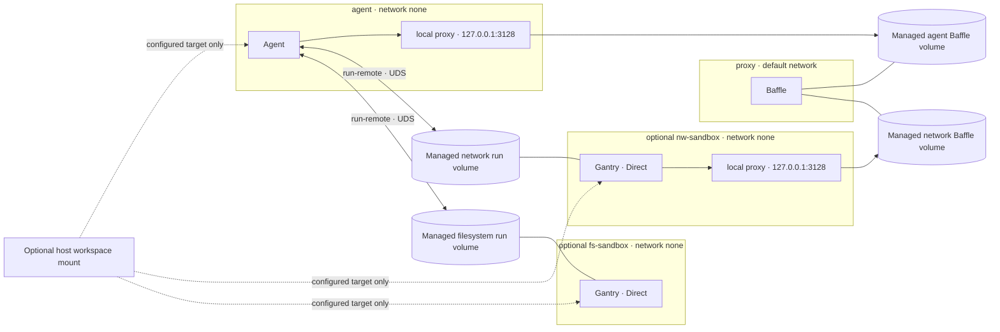

# Cladding

Cladding lets you run an agent in a constrained container environment where network access is intentionally narrow:

- The agent runs in a standalone container with `--network none`. Optional delegated sandboxes also run in standalone containers with `--network none`.
- A standalone proxy container runs Baffle. The agent and optional network sandbox can use its local HTTP proxy when Baffle policy allows a destination. The filesystem sandbox has no proxy access by default.
- Execution containers communicate through Unix-domain sockets in Podman-managed volumes. Cladding does not create host socket directories for these channels.
- The network and filesystem sandboxes each serve [Gantry v0.4.8](https://github.com/dstoc/gantry/releases/tag/v0.4.8) with the Direct backend on a mounted Unix socket. Their Rego policies under `.cladding/config/` control command access.
- Proxy rules use native Baffle TOML under `.cladding/config/proxy/`.

Cladding does not mount the host workspace by default. Configure an explicit host-backed mount for any files an execution container must use. The proxy also denies destinations by default until you add a Baffle rule.

## Release installation

Prebuilt release binaries are published for these targets:

- Linux x86_64 (`x86_64-unknown-linux-gnu`)
- Linux aarch64 (`aarch64-unknown-linux-gnu`)
- macOS Apple Silicon (`aarch64-apple-darwin`)

No Intel macOS release binary is published. Install [Podman](https://podman.io/) and make sure its engine is available (`podman info`). On macOS, create a machine with `podman machine init` if needed, then start it with `podman machine start`.

The following commands use the published `v0.4.6` assets. Change `VERSION` to another [published release](https://github.com/dstoc/cladding/releases) when you want a different version.

```bash
VERSION=v0.4.6
case "$(uname -s)-$(uname -m)" in
  Linux-x86_64) TARGET=x86_64-unknown-linux-gnu ;;
  Linux-aarch64) TARGET=aarch64-unknown-linux-gnu ;;
  Darwin-arm64) TARGET=aarch64-apple-darwin ;;
  *) echo "No Cladding release binary for $(uname -s) $(uname -m)" >&2; exit 1 ;;
esac

ARCHIVE="cladding-${VERSION}-${TARGET}.tar.gz"
curl -fL "https://github.com/dstoc/cladding/releases/download/${VERSION}/${ARCHIVE}" -o "$ARCHIVE"
tar -xzf "$ARCHIVE"
mkdir -p "$HOME/.local/bin"
install -m 0755 "cladding-${VERSION}-${TARGET}/cladding" "$HOME/.local/bin/cladding"
export PATH="$HOME/.local/bin:$PATH"
cladding --version
```

The archive names are `cladding-v0.4.6-x86_64-unknown-linux-gnu.tar.gz`, `cladding-v0.4.6-aarch64-unknown-linux-gnu.tar.gz`, and `cladding-v0.4.6-aarch64-apple-darwin.tar.gz`.

## Quick start

From the project directory, initialize Cladding:

```bash
cladding init
```

Edit `.cladding/cladding.json` and add this top-level `mounts` entry. It gives only the agent read-only access to this project's files at `/workspace`; `hostPath` is relative to `.cladding/`.

```json
"mounts": [
  {
    "mount": "/workspace",
    "hostPath": "..",
    "type": "readonly",
    "targets": ["agent"]
  }
]
```

Create a marker file, install the pinned tools, build the images, check the project, and start the containers:

```bash
printf 'workspace mount works\n' > .cladding-quickstart
cladding build
cladding check
cladding up
cladding exec --target agent cat /workspace/.cladding-quickstart
rm .cladding-quickstart
cladding down
```

The `cat` command verifies that the agent can read an explicitly mounted host file. The read-only mount prevents the agent from changing host files. A successful `cladding up` does not grant workspace access or network access. Add only the host paths and Baffle destinations your workflow needs.

The first `cladding build` downloads the checksum-pinned Linux tools for the selected Podman guest architecture. Later builds reuse matching files without a download. See the [tool installation guide](docs/features/baffle-integration/embedded-baffle.md) for development overrides and release verification.

## Runtime overview

The proxy uses Podman's default network. The agent and enabled sandboxes use `--network none`. Baffle denies unmatched destinations. Podman-managed volumes carry the Baffle and sandbox sockets between their owning containers.



The filesystem sandbox has no Baffle socket, proxy environment, or CA mount by default; it is not a proxy client. The default `/home/user` mount is Cladding's project home, not the host workspace. The persistent project CA and credentials stay under `.cladding/credentials/baffle/`.

See the [current runtime summary](docs/features/current-runtime-summary.md) for the topology and lifecycle details.

## Advanced references

- [Mounts and workspace access](docs/user-guide/mounts.md)
- [Runtime commands and configuration selection](docs/user-guide/runtime-and-commands.md)
- [Custom container images](docs/user-guide/custom-images.md)
- [Fake credentials for `cladding run`](docs/user-guide/fake-credentials.md)
- [Proxy policy, CA, and credentials](docs/features/proxy/summary.md)
- [Baffle session-file migration](docs/features/baffle-integration/embedded-baffle.md#session-file-migration)
