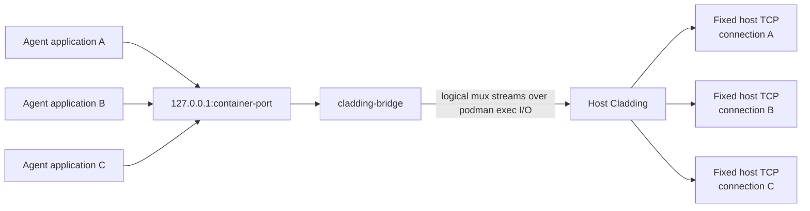
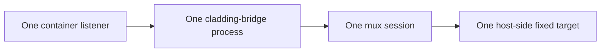
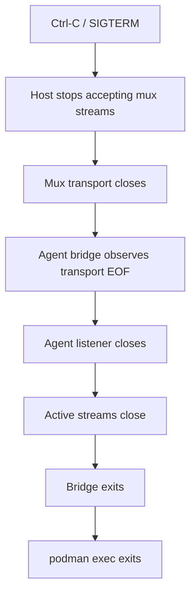
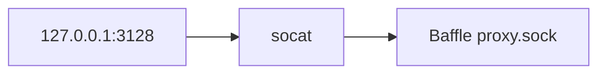
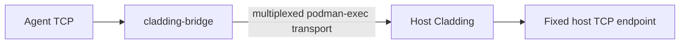

# Cladding Bridge: Multiplexed fixed-endpoint transport

## Summary

Introduce a small Cladding-owned multiplexed transport for carrying connections between a container and a host-controlled fixed endpoint over one long-lived `podman exec` stdin/stdout stream.

The first implementation consumer remains `cladding inject`:

- replace its host-shared Unix-domain-socket transport;
- remove its dependence on `socat`;
- work identically with local Podman and Podman Machine;
- support multiple concurrent connections over one long-lived exec transport;
- preserve the existing user-facing `cladding inject` semantics.

The transport should, however, be reusable by a second concrete consumer: a future migration of Baffle out of the Podman Machine and onto the physical host. That future migration needs the same container-to-host byte-stream transport, but with a host Unix-domain socket as the fixed destination rather than a host TCP endpoint.

This proposal therefore generalizes the bridge one level above `inject`:


The host endpoint may be TCP or Unix-domain socket. The untrusted container side never selects or communicates the destination.

Actual Baffle migration is explicitly outside this project and should be planned as a separate set of implementation tasks after the bridge has landed and been proven by `cladding inject`.

## Context

### Current `cladding inject`

Today `cladding inject` temporarily makes a host-reachable TCP endpoint available inside the agent container.

For example:

```text
cladding inject localhost:5432 15432
```

allows software in the agent to connect to `127.0.0.1:15432` and have that connection forwarded to host `localhost:5432`.

The current implementation uses two `socat` processes and a host-backed Unix socket:


This is reasonable for local Podman, but the host-backed UDS becomes problematic with Podman Machine:

- the agent is inside a VM;
- the Unix socket lives on the physical host;
- exposing a host Unix socket into the VM requires shared-filesystem/socket behaviour that should not be part of the security or runtime architecture;
- local Podman and Podman Machine therefore require different assumptions.

The existing design also requires `socat` both on the host and inside the agent image, creates filesystem state for every injection, and requires process-pattern cleanup of the agent listener.

### Future Baffle placement

Baffle currently runs inside the same Podman environment as the execution containers, so Cladding can expose Baffle's Unix sockets through Podman-managed volumes and adapt them to local TCP with `socat`.

A stronger isolation model is to move trusted Baffle outside the Podman Machine while keeping untrusted execution containers inside it. That removes Baffle's credentials and process from the VM, but also removes the shared Podman-volume transport.

The desired future shape is approximately:


This is structurally the same transport problem as `cladding inject`: multiple byte streams cross the Podman/VM boundary and terminate at one host-selected fixed destination.

That gives the bridge a second concrete consumer and justifies making the core transport reusable now. It does **not** justify turning the bridge into a general tunnel or moving Baffle as part of this proposal.

## Goals

The bridge transport should:

1. Work with both local Podman and Podman Machine using the same topology.
2. Require no host-shared Unix socket or host bind mount for cross-boundary transport.
3. Carry multiple simultaneous byte streams over one long-lived `podman exec` stdin/stdout connection.
4. Keep the destination fixed and entirely selected by trusted host-side Cladding.
5. Support host-side fixed destinations that are either TCP endpoints or Unix-domain sockets.
6. Preserve ordinary full-duplex stream semantics, including half-close behaviour.
7. Provide bounded buffering, bounded concurrency, deterministic startup, and bounded shutdown.
8. Keep the agent-side helper small and unaware of host routing details.
9. Let consumers own their own lifecycle and policy rather than embedding `inject` or Baffle semantics into the mux core.
10. Use `cladding inject` as the first implementation consumer and validation path.

## Non-goals

This project does not:

- migrate Baffle out of the Podman Machine;
- change Baffle process placement, credential storage, data sockets, or control sockets;
- replace the current Baffle `socat` bridges yet;
- change `cladding expose`;
- replace `mcp-run` / `run-remote` Unix sockets;
- provide destinations selected by the agent or bridge helper;
- provide SOCKS, HTTP CONNECT, arbitrary routing, port-forwarding configuration, or a generic tunnel protocol;
- provide UDP forwarding;
- provide TLS termination;
- provide persistent VM-wide tunnels;
- multiplex unrelated Cladding capabilities through one global transport;
- require one always-running bridge daemon inside the Podman Machine.

A later Baffle project may reuse the transport and host-UDS target support defined here. A later `cladding expose` project may reuse the mux core in the opposite direction. Neither is implemented here.

## Proposed architecture

Introduce a small embedded Linux helper, tentatively named `cladding-bridge`, plus reusable host-side/core Rust code.

For `cladding inject`, host Cladding starts the helper inside the already-running agent with one interactive `podman exec`:

```text
podman exec -i <agent-container> \
    /opt/tools/bin/cladding-bridge listen \
    --tcp 127.0.0.1:<container-port>
```

stdin/stdout of that exec become a multiplexed binary transport between host Cladding and `cladding-bridge` inside the agent.

The resulting inject data path is:



Every connection accepted by the container-side listener creates a new logical stream. For each logical stream, trusted host Cladding opens a fresh connection to the one fixed endpoint configured for that bridge session.

The future Baffle consumer would use the same shape, but host Cladding would connect each stream to a fixed host-side Unix socket instead of TCP.

## Fixed-endpoint capability boundary

The bridge must **not** allow the untrusted side to choose a destination.

For:

```text
cladding inject db.internal:5432 15432
```

the capability granted to the agent is:

```text
connect repeatedly to exactly db.internal:5432
```

Similarly, a future Baffle bridge session might grant only:

```text
connect repeatedly to exactly /run/cladding/baffle/agent/proxy.sock
```

The destination is not protocol data. It is configuration held by trusted host-side Cladding when the bridge session is created.

The agent-side helper communicates only:

- session startup/version state;
- new logical streams;
- stream bytes;
- stream EOF/half-close/reset state.

It must never send destination requests such as:

```text
CONNECT 10.0.0.5:22
OPEN /some/arbitrary/socket
```

This keeps each bridge session a narrow capability to one preselected endpoint rather than turning it into a general tunnel into the host or host network.

## Host target abstraction

The reusable host side should support exactly the target types justified by known consumers:

```text
TCP host:port
Unix-domain socket path
```

Conceptually:

```rust
HostTarget::Tcp(...)
HostTarget::Unix(...)
```

The target object belongs to trusted host-side code and is never serialized into the mux protocol.

`cladding inject` uses only `HostTarget::Tcp` in this project.

Unix target support should be exercised by focused unit tests so that the bridge core is genuinely reusable, but no Baffle runtime code should be changed here.

Do not generalize this into arbitrary target descriptors, target IDs supplied by the remote peer, dynamic routing tables, or a generic forwarding configuration language.

## Session model

One bridge session represents one fixed local listener and one fixed host destination.



Multiple accepted connections become multiple logical streams within that session.

This proposal deliberately does not introduce one persistent VM-wide mux carrying `inject`, Baffle, `expose`, and other future capabilities. Separate exec-backed sessions preserve simple lifecycle and capability boundaries:

- the container is explicit;
- the local listener is explicit;
- the host target is explicit;
- closing the exec transport revokes the whole session.

If the number or cost of exec transports later becomes a demonstrated problem, a VM-level transport such as vsock or a persistent mux can be evaluated separately.

## Multiplexing

Use an established Rust stream-multiplexing implementation rather than defining a custom framing protocol. Yamux is the preferred starting point unless implementation investigation identifies a materially better fit.

The mux library should be reusable independently of `cladding inject` CLI concepts.

No routing metadata is required in logical streams because every stream in a session has the same fixed destination.

## Transport establishment

A consumer of the bridge transport should:

1. Select the execution container.
2. Select the container-local listener.
3. Select the fixed host destination.
4. Start one interactive `podman exec -i` running `cladding-bridge`.
5. Wait for an explicit bridge readiness indication.
6. Enter the mux session.
7. For each incoming logical stream, connect to the already-selected host target and relay bytes bidirectionally.
8. Tie session shutdown to the consumer's lifecycle.

For `cladding inject`, the host command performs these steps directly and remains in the foreground.

The helper should not bind its listener until its configuration has been validated. The consumer should not report ready until the remote listener has successfully bound.

This removes timing sleeps and gives deterministic errors for cases such as:

- port already in use;
- helper missing;
- incompatible helper version;
- execution container disappearing;
- `podman exec` failure.

## Protocol startup

Before multiplexing begins, use a minimal version/readiness handshake. The exact encoding is an implementation detail, but it should provide at least:

- protocol version;
- bridge ready;
- listener bind/startup failure.

Once the mux begins, stdout becomes protocol data and must never contain logging or diagnostic text. Diagnostics from `cladding-bridge` must go to stderr.

A protocol version mismatch should fail closed with a clear host-side error.

The handshake must not introduce target negotiation. Host destination type and address/path remain entirely host-local configuration.

## Stream semantics

Each logical stream represents one ordinary connected byte stream.

Required behaviour:

- full-duplex byte transparency;
- independent concurrent streams;
- bounded buffering and backpressure;
- no global blocking when one connection is slow;
- propagate EOF and half-close correctly where supported by the endpoint type;
- one failed destination connection affects only that logical stream;
- transport failure terminates the entire bridge session;
- idle connections may remain open indefinitely.

When one side reaches EOF, the corresponding write side of the opposite stream/socket should be shut down while allowing the reverse direction to continue until it also completes.

The implementation should place a reasonable upper bound on concurrent logical streams to prevent accidental unbounded host file-descriptor consumption. The exact default may be chosen during implementation; it should be comfortably above normal coding-agent workloads.

## `cladding inject` integration

Existing CLI behaviour should be preserved.

```text
cladding inject 5432
```

continues to mean host `localhost:5432` exposed as agent `localhost:5432`.

```text
cladding inject db.internal:5432 15432
```

continues to mean host `db.internal:5432` exposed as agent `127.0.0.1:15432`.

With Podman Machine, host `localhost` must continue to mean the physical host process running `cladding`, not the Podman Machine VM. This is one of the principal reasons to terminate the host target connection in the physical-host Cladding process.

`cladding inject` remains a blocking foreground command.

Normal shutdown should be:



There should be no `pkill -f` cleanup.

The bridge process exists only as the child of the interactive `podman exec`, so losing the transport should naturally terminate it. Host-side shutdown should still have bounded waits and a forced termination fallback for abnormal cases.

## `cladding inject` runtime topology changes

The current inject-specific host socket topology can be removed:

```text
.cladding/runtime/sockets/agent/inject/
/run/cladding/agent/inject
```

and `/run/cladding/agent/inject` should no longer be mounted into the agent.

The following inject-specific objects become unnecessary:

```text
<port>/host.sock
host socat process
agent socat process
inject socket-directory cleanup
agent listener pkill cleanup
```

This leaves Cladding's normal inter-container Unix sockets managed inside Podman volumes rather than requiring a special host-backed socket path for inject.

## Helper packaging

`cladding-bridge` should be built as an embedded Linux helper alongside the existing execution helpers.

Required architectures:

```text
x86_64-unknown-linux-gnu
aarch64-unknown-linux-gnu
```

It should be materialized into `/opt/tools/bin/cladding-bridge` and therefore become available in execution containers through Cladding's existing `/opt/tools` mount. The helper should not need to exist in custom agent images themselves.

The CI embedded-tools artifact should contain it alongside the existing helper binaries.

The helper naming and CLI should be transport-oriented rather than inject-specific so later consumers can reuse it without pretending to invoke `cladding inject` internals.

## Relationship to Baffle

Baffle is now a concrete future consumer of this transport, not merely hypothetical generalization.

A later Baffle migration can use the reusable bridge roughly as:


This would allow Baffle and its credentials to live outside the Podman Machine while exposing only the intended proxy capability to each execution container.

That migration has substantially different lifecycle and security requirements from `cladding inject`:

- it is runtime infrastructure rather than a foreground user command;
- sessions are created automatically with execution containers;
- failures affect runtime startup/health;
- Baffle socket ownership and per-component capability boundaries must be preserved;
- old Podman socket volumes and local `socat` bridges need their own migration and cleanup plan.

For those reasons, this proposal provides the reusable transport primitives but deliberately does **not** migrate Baffle. Baffle migration should be a separate proposal/task graph after this bridge project lands.

## Relationship to `socat`

This proposal removes `socat` only from `cladding inject`.

The current Baffle compatibility bridge remains unchanged for now:



That topology remains local to the current Podman environment until the separate Baffle migration project changes Baffle placement.

The principle is:

> Replace transport topology when a concrete boundary requires it; do not mechanically replace every `socat` use just because `cladding-bridge` exists.

## Relationship to `cladding expose`

`cladding expose` has a structurally similar inverse problem and could later reuse the mux implementation:


However, expose is explicitly outside this project.

The mux/core implementation should avoid unnecessary coupling to inject-specific concepts, but should not add reverse-direction APIs or abstractions solely for hypothetical expose reuse. Generalize further when that consumer is actually implemented.

## Testing

### Core transport tests

Unit tests should cover:

- listener configuration;
- handshake/version validation;
- multiple simultaneous logical streams;
- byte-transparent bidirectional copying;
- destination connection failure isolated to one stream;
- half-close handling;
- stream concurrency limits;
- mux transport failure;
- clean remote exit after transport EOF;
- fixed TCP host target connection handling;
- fixed Unix-socket host target connection handling;
- proof that the remote protocol carries no destination selection.

### `cladding inject` integration tests

Integration testing should cover local rootless Podman and Podman Machine.

For local rootless Podman, start a normal Cladding runtime and verify an agent connection reaches a host-side test service, including multiple simultaneous connections. Verify that stopping `cladding inject` removes the listener and leaves no socket artifacts or helper process behind.

For Podman Machine, run the same test through the configured rootless Podman Machine connection. The test must specifically prove that `cladding inject localhost:<port>` reaches a service listening on the physical CI host rather than a service inside the VM. This is the primary topology regression this project is intended to prevent.

Failure coverage should include:

- agent listener port already occupied;
- host destination unavailable;
- agent container stops during inject;
- Podman Machine connection disappears;
- helper exits unexpectedly;
- host command receives SIGINT/SIGTERM.

All waits must be bounded so failed tunnel cleanup cannot hang CI.

No Baffle integration test or runtime migration is required in this project. Unix-target behaviour should be covered at the reusable transport layer only.

## Documentation changes

Update runtime documentation to describe inject as:



Remove references to:

```text
runtime/sockets/agent/inject
/run/cladding/agent/inject
inject host.sock
inject socat processes
```

Document the bridge itself as a fixed-endpoint transport whose host target may be TCP or Unix socket, while noting that only TCP is used by production runtime code in this project.

Keep existing Baffle runtime documentation unchanged except where useful to point to Baffle migration as separate future work.

## Completion criteria

The project is complete when:

1. A reusable fixed-endpoint bridge core exists and supports host-side TCP and Unix-socket targets.
2. The remote bridge protocol contains no destination-selection capability.
3. `cladding inject` uses one long-lived multiplexed `podman exec` transport.
4. Multiple simultaneous agent connections work correctly.
5. The inject destination is fixed by the host invocation and cannot be selected by the agent.
6. Local Podman and Podman Machine use the same inject architecture.
7. Host `localhost` targets resolve on the physical host under Podman Machine.
8. The inject host-backed UDS mount and socket directories are removed.
9. `cladding inject` no longer invokes or requires `socat`.
10. No `pkill` or process-pattern cleanup is required.
11. Normal and failure shutdown paths are bounded and covered by tests.
12. Existing Baffle runtime topology remains unchanged.
13. The design records Baffle host migration as the next concrete bridge consumer but leaves that migration to a separate task set.