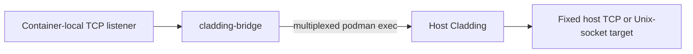
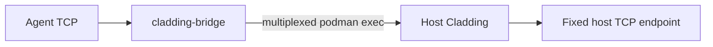
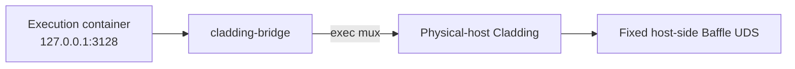
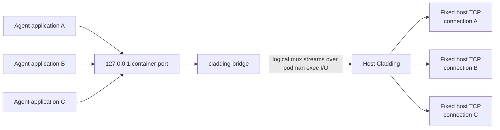
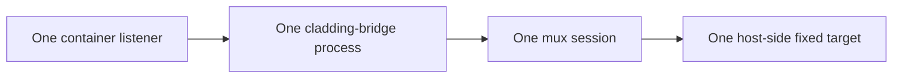
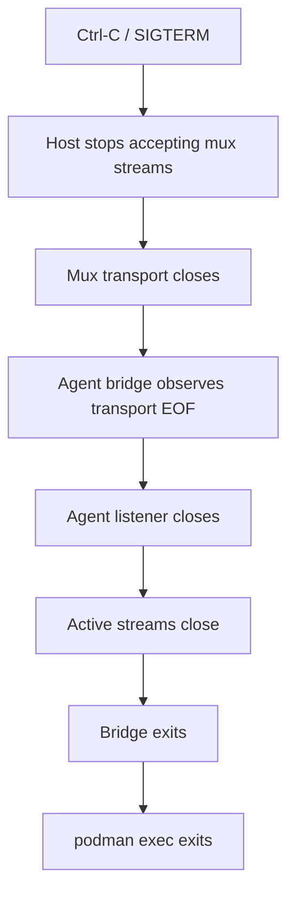
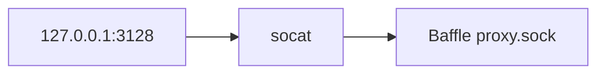

# Cladding Bridge: Multiplexed fixed-endpoint transport

## Summary

Cladding provides a small reusable bridge for carrying TCP connections from a container-local listener to one host-controlled fixed endpoint over a long-lived multiplexed `podman exec` stream.

`cladding inject` is the only production consumer. It uses a fixed host TCP endpoint and works with local Podman and Podman Machine.

The bridge supports fixed host TCP and Unix-socket targets. The remote helper does not select a target. This is the reusable boundary justified by the current consumer and a possible future Baffle migration:



Moving Baffle, changing its lifecycle, or removing its Podman socket volumes and local `socat` bridges are separate future work. Plan that migration through its own proposal and task graph because it changes trusted-component placement, credential isolation, startup and health behavior, and cleanup semantics.

## Context

### `cladding inject` in the current runtime

Today `cladding inject` temporarily makes a host-reachable TCP endpoint available inside the agent container.

For example:

```text
cladding inject localhost:5432 15432
```

allows software in the agent to connect to `127.0.0.1:15432` and have that connection forwarded to host `localhost:5432`.

Host Cladding starts `cladding-bridge` inside the agent through one interactive `podman exec`. The agent-side helper listens on loopback; the host-side Cladding process opens each accepted stream to the one endpoint selected by the command:



The host endpoint is fixed by the host invocation. The agent cannot request another destination. Host `localhost` resolves on the physical host, including when Podman runs in a VM.

### Future Baffle placement

Baffle currently runs inside the same Podman environment as the execution containers, so Cladding can expose Baffle's Unix sockets through Podman-managed volumes and adapt them to local TCP with `socat`.

A stronger isolation model is to move trusted Baffle outside the Podman Machine while keeping untrusted execution containers inside it. That removes Baffle's credentials and process from the VM, but also removes the shared Podman-volume transport.

The possible future Baffle direction is:



This has the same fixed-endpoint byte-stream shape as `cladding inject`, with a Unix socket target. It is not implemented here. Baffle placement, lifecycle, credentials, startup and health behavior, and cleanup must be designed as a separate proposal and task graph.

## Bridge properties

The bridge transport has these properties:

- It works with local Podman and Podman Machine using the same topology.
- It needs no host-shared Unix socket or host bind mount for cross-boundary transport.
- It carries multiple simultaneous byte streams over one long-lived `podman exec` stdin/stdout connection.
- Trusted host-side Cladding selects one fixed destination.
- Host-side targets are TCP endpoints or Unix-domain sockets.
- Streams have full-duplex semantics, including half-close behavior.
- Buffering, concurrency, startup, and shutdown are bounded.
- The agent-side helper is small and has no host-routing details.
- Consumers own their lifecycle and policy; the mux core has no `inject` or Baffle semantics.
- `cladding inject` is the only production consumer and the transport validation path.

## Non-goals

This project does not:

- migrate Baffle out of the Podman Machine;
- change Baffle process placement, credential storage, data sockets, or control sockets;
- replace the current Baffle `socat` bridges yet;
- change `cladding expose`;
- replace `mcp-run` / `run-remote` Unix sockets;
- provide destinations selected by the agent or bridge helper;
- provide SOCKS, HTTP CONNECT, arbitrary routing, port-forwarding configuration, or a generic tunnel protocol;
- provide UDP forwarding;
- provide TLS termination;
- provide persistent VM-wide tunnels;
- multiplex unrelated Cladding capabilities through one global transport;
- require one always-running bridge daemon inside the Podman Machine.

A separate Baffle migration may reuse the transport and host Unix-socket target support defined here. It is not implemented here.

## Architecture

The embedded Linux helper is named `cladding-bridge`. Reusable host-side Rust code owns the fixed target and multiplexed transport.

For `cladding inject`, host Cladding starts the helper inside the already-running agent with one interactive `podman exec`:

```text
podman exec -i <agent-container> \
    /opt/tools/bin/cladding-bridge listen \
    --tcp 127.0.0.1:<container-port>
```

stdin/stdout of that exec become a multiplexed binary transport between host Cladding and `cladding-bridge` inside the agent.

The inject data path is:



Every connection accepted by the container-side listener creates a new logical stream. For each logical stream, trusted host Cladding opens a fresh connection to the one fixed endpoint configured for that bridge session.

The possible future Baffle consumer can use the same shape, with host Cladding connecting each stream to a fixed host-side Unix socket instead of TCP.

## Fixed-endpoint capability boundary

The bridge must **not** allow the untrusted side to choose a destination.

For:

```text
cladding inject db.internal:5432 15432
```

the capability granted to the agent is:

```text
connect repeatedly to exactly db.internal:5432
```

Similarly, a future Baffle bridge session might grant only:

```text
connect repeatedly to exactly /run/cladding/baffle/agent/proxy.sock
```

The destination is not protocol data. It is configuration held by trusted host-side Cladding when the bridge session is created.

The agent-side helper communicates only:

- session startup/version state;
- new logical streams;
- stream bytes;
- stream EOF/half-close/reset state.

It must never send destination requests such as:

```text
CONNECT 10.0.0.5:22
OPEN /some/arbitrary/socket
```

This keeps each bridge session a narrow capability to one preselected endpoint rather than turning it into a general tunnel into the host or host network.

## Host target abstraction

The reusable host side supports the target types justified by the current and planned consumers:

```text
TCP host:port
Unix-domain socket path
```

Conceptually:

```rust
HostTarget::Tcp(...)
HostTarget::Unix(...)
```

The target object belongs to trusted host-side code and is never serialized into the mux protocol.

`cladding inject` uses only `HostTarget::Tcp` in production.

Unit tests exercise Unix target support. The current Baffle runtime does not use this bridge.

Do not generalize this into arbitrary target descriptors, target IDs supplied by the remote peer, dynamic routing tables, or a generic forwarding configuration language.

## Session model

One bridge session represents one fixed local listener and one fixed host destination.



Multiple accepted connections become multiple logical streams within that session.

This proposal deliberately does not introduce one persistent VM-wide mux carrying `inject`, Baffle, `expose`, and other future capabilities. Separate exec-backed sessions preserve simple lifecycle and capability boundaries:

- the container is explicit;
- the local listener is explicit;
- the host target is explicit;
- closing the exec transport revokes the whole session.

If the number or cost of exec transports later becomes a demonstrated problem, a VM-level transport such as vsock or a persistent mux can be evaluated separately.

## Multiplexing

The bridge uses Yamux rather than a custom framing protocol.

The `cladding-bridge` crate is reusable independently of `cladding inject` CLI concepts.

No routing metadata is required in logical streams because every stream in a session has the same fixed destination.

## Transport establishment

`cladding inject` establishes a bridge session by:

1. Parse the fixed host TCP endpoint and select the running agent.
2. Start one interactive `podman exec -i` running `cladding-bridge` with the loopback listener address.
3. Wait for the helper's readiness handshake, which follows a successful listener bind.
4. Enter the Yamux session and connect each incoming logical stream to the selected host target.
5. Close the session when the foreground command ends.

This removes timing sleeps and gives deterministic errors for cases such as:

- port already in use;
- helper missing;
- incompatible helper version;
- execution container disappearing;
- `podman exec` failure.

## Protocol startup

Before multiplexing begins, the bridge uses a version/readiness handshake. It reports:

- protocol version;
- bridge ready;
- listener bind/startup failure.

Once the mux begins, stdout becomes protocol data and must never contain logging or diagnostic text. Diagnostics from `cladding-bridge` must go to stderr.

A protocol version mismatch fails closed with a clear host-side error.

The handshake must not introduce target negotiation. Host destination type and address/path remain entirely host-local configuration.

## Stream semantics

Each logical stream represents one ordinary connected byte stream.

Required behavior:

- full-duplex byte transparency;
- independent concurrent streams;
- bounded buffering and backpressure;
- no global blocking when one connection is slow;
- propagate EOF and half-close correctly where supported by the endpoint type;
- one failed destination connection affects only that logical stream;
- transport failure terminates the entire bridge session;
- idle connections may remain open indefinitely.

When one side reaches EOF, the bridge shuts down the corresponding write side of the opposite stream/socket and allows the reverse direction to continue until it also completes.

The bridge limits each session to 64 concurrent logical streams to bound host file-descriptor use.

## `cladding inject` integration

Existing CLI behavior is preserved.

```text
cladding inject 5432
```

continues to mean host `localhost:5432` exposed as agent `localhost:5432`.

```text
cladding inject db.internal:5432 15432
```

continues to mean host `db.internal:5432` exposed as agent `127.0.0.1:15432`.

With Podman Machine, host `localhost` must continue to mean the physical host process running `cladding`, not the Podman Machine VM. This is one of the principal reasons to terminate the host target connection in the physical-host Cladding process.

`cladding inject` remains a blocking foreground command.

Normal shutdown follows this sequence:



Shutdown requires no process-pattern cleanup.

The bridge process exists only as the child of the interactive `podman exec`, so losing the transport should naturally terminate it. Host-side shutdown should still have bounded waits and a forced termination fallback for abnormal cases.

## Runtime integration

`cladding inject` uses an interactive `podman exec` for the lifetime of the foreground command. The agent-side listener and mux helper run as that exec process. Host Cladding opens each logical stream to the fixed TCP endpoint selected by the command.

Inject does not add a host-backed socket mount or a separate runtime container. Closing the command closes the mux transport and the agent listener. The existing Baffle and sandbox Unix sockets remain managed by their current Podman volumes.

## Helper packaging

`cladding-bridge` is built as an embedded Linux helper alongside the existing execution helpers.

Required architectures:

```text
x86_64-unknown-linux-gnu
aarch64-unknown-linux-gnu
```

It is materialized into `/opt/tools/bin/cladding-bridge` and is available in execution containers through Cladding's existing `/opt/tools` mount. Custom agent images do not need to include it.

The CI embedded-tools artifact should contain it alongside the existing helper binaries.

The helper has a transport-oriented CLI so a future consumer can reuse it without invoking `cladding inject` internals.

## Relationship to Baffle

Baffle may become a future consumer of this transport. Its current runtime remains local to the Podman environment. A separate migration could use this shape:


This direction would place Baffle and its credentials outside the Podman Machine while exposing only the intended proxy capability to each execution container. It is separate future work because it changes:

- Baffle is runtime infrastructure rather than a foreground user command;
- sessions are created automatically with execution containers;
- failures affect runtime startup and health;
- Baffle socket ownership and per-component capability boundaries must be preserved;
- Podman socket volumes and local `socat` bridges need a separate migration and cleanup plan.

Do not combine Baffle placement, lifecycle changes, or Podman socket-volume removal with this bridge work. Give the migration its own proposal and task graph.

## Relationship to `socat`

Production `cladding inject` code does not use `socat`. The current Baffle compatibility bridge remains unchanged:



That bridge remains local to the current Podman environment. Any change to it belongs to the separate Baffle migration.

The principle is:

> Replace transport topology when a concrete boundary requires it; do not mechanically replace every `socat` use just because `cladding-bridge` exists.

## Testing

### Core transport tests

Unit tests cover:

- listener configuration;
- handshake/version validation;
- multiple simultaneous logical streams;
- byte-transparent bidirectional copying;
- destination connection failure isolated to one stream;
- half-close handling;
- stream concurrency limits;
- mux transport failure;
- clean remote exit after transport EOF;
- fixed TCP host target connection handling;
- fixed Unix-socket host target connection handling;
- proof that the remote protocol carries no destination selection.

### `cladding inject` integration tests

Integration tests cover local rootless Podman and Podman Machine.

For local rootless Podman, start a normal Cladding runtime and verify an agent connection reaches a host-side test service, including multiple simultaneous connections. Verify that stopping `cladding inject` removes the listener and leaves no socket artifacts or helper process behind.

For Podman Machine, run the same test through the configured rootless Podman Machine connection. The test must specifically prove that `cladding inject localhost:<port>` reaches a service listening on the physical CI host rather than a service inside the VM. This is the primary topology regression this project is intended to prevent.

Failure coverage includes:

- agent listener port already occupied;
- host destination unavailable;
- agent container stops during inject;
- Podman Machine connection disappears;
- helper exits unexpectedly;
- host command receives SIGINT/SIGTERM.

All waits must be bounded so failed tunnel cleanup cannot hang CI.

This project requires no Baffle integration test or runtime migration. Unit tests cover Unix-target behavior at the reusable transport layer.

## Documented production boundary

The production `cladding inject` flow is:


The bridge target can be TCP or Unix socket. Production runtime code uses TCP for `cladding inject`. The future Baffle diagram above is not current runtime documentation.

## Completion criteria

The implemented architecture has these properties:

1. A reusable fixed-endpoint bridge core exists and supports host-side TCP and Unix-socket targets.
2. The remote bridge protocol contains no destination-selection capability.
3. `cladding inject` uses one long-lived multiplexed `podman exec` transport.
4. Multiple simultaneous agent connections work correctly.
5. The inject destination is fixed by the host invocation and cannot be selected by the agent.
6. Local Podman and Podman Machine use the same inject architecture.
7. Host `localhost` targets resolve on the physical host under Podman Machine.
8. Inject uses no host-backed socket mount.
9. `cladding inject` does not invoke or require `socat`.
10. No `pkill` or process-pattern cleanup is required.
11. Normal and failure shutdown paths are bounded and covered by tests.
12. The current Baffle runtime topology, including its local `socat` bridges, remains unchanged.
13. Baffle migration, lifecycle changes, and Podman socket-volume removal are separate future work with their own proposal and task graph.
