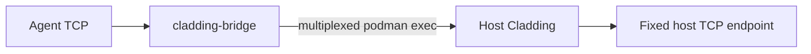
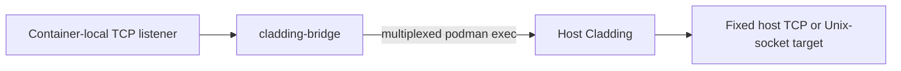
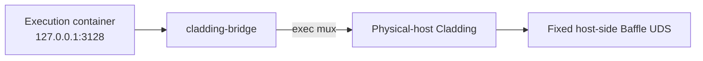

# `cladding inject`: Fixed-endpoint host bridge

## Objective

`cladding inject` lets processes in the agent container connect to one
host-reachable TCP endpoint through the agent's loopback interface. The
foreground command owns the connection for its lifetime.

```bash
cladding inject <host-endpoint> [container-port]
```

## User behavior

The agent listens on `127.0.0.1:<container-port>`. When the optional
container port is omitted, it uses the endpoint port.

```bash
cladding inject 11434
cladding inject 5432 15432
cladding inject db.internal:5432 15432
```

A bare port selects the same port on host `127.0.0.1`. An explicit
`host:port` selects that host endpoint. The host resolves and opens the
endpoint. With Podman Machine, host `localhost` means the physical host where
Cladding runs. The command stays in the foreground until interrupted.

The host invocation fixes the destination for the session. The agent can open
multiple connections to that destination, but cannot select another host or
port. This is a temporary exception for one endpoint, not general host-network
access.

## Production architecture

Host Cladding starts `cladding-bridge` in the running agent with one interactive
`podman exec`. The agent helper listens on loopback and multiplexes accepted
connections over the exec stream. Host Cladding opens each logical stream to
the fixed TCP endpoint selected by the command.



The transport is the same with local Podman and Podman Machine. Cladding does
not create a runtime container or host-backed socket mount for inject. The
interactive exec owns the agent listener; closing the transport ends that
listener and its streams.

## Reusable bridge boundary

`cladding-bridge` is a fixed-endpoint byte-stream bridge. Its host-side target
can be TCP or a Unix socket. The destination remains host-side configuration
and is not sent by the remote helper. `cladding inject` is the only production
consumer, and it uses a TCP target.



## Separate future Baffle work

A future Baffle migration could use the same bridge to connect an execution
container's local proxy endpoint to a fixed host-side Baffle socket:



This is not the current Baffle runtime. Moving Baffle, changing its lifecycle,
or removing its Podman socket volumes and local `socat` bridges are separate
future work. Plan that migration in its own proposal and task graph because it
changes trusted-component placement, credential isolation, startup and health
behavior, and cleanup semantics.

## Scope

This feature does not:

- give the agent general host-network access or change its network mode;
- allow the agent or bridge helper to choose a destination;
- create persistent inject mappings or detached inject containers;
- add inject support for the sandbox containers;
- change Baffle placement, runtime lifecycle, credentials, Podman socket
  volumes, or local `socat` bridges;
- change `cladding expose` or use the mux transport for expose;
- replace `podman exec` with a persistent VM-level transport such as vsock.

## Verification

The bridge tests cover fixed TCP and Unix-socket targets, multiplexed streams,
stream shutdown, and the absence of destination selection in the remote
protocol. Inject tests cover host target selection, command construction,
listener startup errors, and exec shutdown. Runtime topology validation covers
local Podman and Podman Machine, including host-loopback access, concurrent
connections, lifecycle cleanup, and the absence of the retired host-backed
inject mount. Production inject code must not use `socat`; the local `socat`
bridges for Baffle remain in the runtime component definitions.
