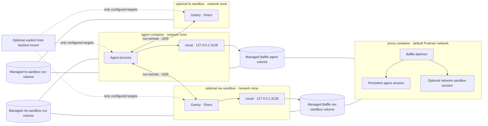

# Current Runtime Summary

This file summarizes the current Cladding runtime. See the [user guide](../user-guide/runtime-and-commands.md) for command behavior, [mount reference](../user-guide/mounts.md) for workspace access, and [proxy reference](proxy/summary.md) for Baffle policy and trust details.

## Managed resources

- One standalone proxy container per active run: `<run-name>-proxy-instance`.
- One standalone agent container per active run: `<run-name>-agent-instance`.
- Optional standalone network and filesystem sandbox containers per run: `<run-name>-nw-sandbox-instance` and `<run-name>-fs-sandbox-instance`.
- Podman-managed volumes carry Baffle data sockets and sandbox run sockets between their owning containers. Cladding does not create host runtime socket directories.

## Per-run topology

All components run as standalone containers with `--userns keep-id`. The proxy uses Podman's default network. The agent and enabled sandboxes use `--network none`. `use_runsc`, when enabled, applies only to the execution containers.

The proxy runs Baffle and creates persistent sessions for the agent and, when enabled, the network sandbox for the lifetime of this run. Each of those clients has a local listener at `127.0.0.1:3128` and its own Baffle data socket. The filesystem sandbox has no Baffle socket, local proxy listener, or proxy environment.

The dashed host mount is optional. Cladding does not mount the host workspace by default. A configured mount applies only to its selected target list. The agent and network sandbox can use the proxy only through their own Baffle socket and only for destinations allowed by their session policy. The filesystem sandbox has neither proxy access nor a CA mount. Direct host execution into a sandbox bypasses the agent-side delegation and policy path.

## Socket volumes

Cladding creates these volumes as components are enabled:

| Volume channel | Mounted in | Socket or mount path |
| --- | --- | --- |
| Baffle agent | Proxy and agent | `/run/cladding/proxy/agent/proxy.sock` |
| Baffle network sandbox | Proxy and network sandbox | `/run/cladding/proxy/nw-sandbox/proxy.sock` |
| Network-sandbox run | Agent and network sandbox | `/run/cladding/run/nw-sandbox/run.sock` |
| Filesystem-sandbox run | Agent and filesystem sandbox | `/run/cladding/run/fs-sandbox/run.sock` |

The agent Baffle volume is mounted at `/run/cladding/proxy` in both the proxy and agent. Baffle creates its agent socket under the volume's `agent/` directory. The network-sandbox Baffle volume is mounted below it at `/run/cladding/proxy/nw-sandbox`; the network sandbox receives only that component volume. Each execution container receives only its own Baffle data volume and its enabled sandbox run volumes.

Baffle binds each session socket directly in its managed volume. Its data socket uses mode `0600` inside a mode-`0700` component directory. The proxy's control socket and runtime configuration stay inside the proxy container, in a private directory under `/run/baffle`. No execution container mounts the Baffle control socket.

The network and filesystem sandboxes start Gantry with `--backend direct`, `--bind-uds`, and `--policy-dir`. The agent calls those sockets through `run-remote`. The agent and network sandbox each keep a `socat` listener on `127.0.0.1:3128` and forward to their own Baffle data socket. No separate proxy bridge container is used.

## Default and optional mounts

The agent and network sandbox receive read-only `/opt/config`, read-only `/opt/tools`, the public project CA at `/run/cladding/ca/baffle.crt`, and Cladding's project home at `/home/user`. The filesystem sandbox receives read-only `/opt/config` and `/opt/tools`; it does not receive the project home or CA. The proxy receives read-only Baffle config, credentials, Baffle binary, and startup script mounts.

These built-in mounts do not expose the host workspace. Add a host-backed mount to `mounts` when a component needs host files. Cladding maps `exec` and `run` working directories through the most-specific configured host-backed mount for the selected target that contains the invocation directory. If no such mount applies, commands start in `/home/user`. When a configured mount contains the private `.cladding` directory, Cladding adds an empty mask at the corresponding container path.

Custom mounts are applied by the direct runtime builder. They do not pass through Kubernetes YAML.

## Run lifecycle

`cladding init` creates project configuration and layout. It materializes embedded config templates under `.cladding/config/` and refreshes the proxy startup script. `cladding build` installs the checksum-pinned Linux tools in `.cladding/tools/bin/`, builds local images, and initializes the project Baffle CA when needed. A matching installed checksum avoids a download. Later builds validate and reuse the CA. `cladding check` validates all four tools offline and reports files that need a build refresh. Neither command initializes or rotates an existing CA.

`cladding run [--env KEY[=VALUE] ...] -- <command> [args...]` owns one UUID-scoped run. The foreground supervisor acquires a private lifetime lock and control socket before it creates containers. It marks the run ready only after required components, Baffle sessions, and fake defaults are available, then prints the full UUID to stderr. Attachments use that UUID to select the run without rereading project configuration. `cladding ps` lists runs across projects on the selected Podman connection.

`cladding exec`, `inject`, `expose`, `logs`, and `reload-proxy` accept `--run SELECTOR`; without a selector, they require exactly one run for the current project. Exact UUID or internal-name matches take precedence over unique substrings. Explicit selection works outside the project and rejects `--config` and `--cladding-dir`.

`cladding stop --run SELECTOR` asks the supervisor to stop the workload, close admissions, and clean up. It confirms completion before returning. `cladding destroy --run SELECTOR` is for orphan recovery; it requires exclusive lifetime-lock ownership and verifies each run-owned container and volume before removal. It preserves project config, tools, credentials, home, CA, and user-named volumes.

Private bind sources, generated scripts, masks, the lifetime lock, and control socket metadata live under `.cladding/runtime/runs/cladding-run-<UUID>` (the socket may use a short private host path if needed). Podman-managed sockets and disposable mounts use run-labeled volumes. The run uses the selected project's config, tools, credentials, home, selected Baffle sessions, and project CA directly. It does not copy those project files into the run directory or initialize a new CA.

The foreground run starts the proxy and enabled execution containers, creates the required Baffle sessions, and waits for those sessions before admitting attachments or starting the primary workload. Startup errors appear in proxy logs and the run exit status. `cladding reload-proxy --run SELECTOR` invokes `baffle reload --all` in the selected run's proxy.

## Baffle policy and trust

`cladding init` creates native Baffle daemon and session TOML under `.cladding/config/proxy/`. Baffle uses `file_only` mode. Session files start with no host rules and set `unmatched = "deny"`, so no proxy destination is allowed until a rule is added. Rules use exact DNS hostnames and explicit ports. Baffle accepts HTTPS origins through HTTP `CONNECT`, not ordinary plaintext HTTP.

The proxy can read the Baffle credential directory, mounted read-only. The agent and network sandbox receive only the public `ca.crt`; they do not receive the private key or secret files. The filesystem sandbox receives no CA. Store injection secret values in protected files under `.cladding/credentials/baffle/secrets/`, not in TOML, arguments, or logs. The proxy receives those files read-only.

For CA bootstrap, rotation, session selection, policy reload, DNS limitations, and credential handling, see the [proxy reference](proxy/summary.md). For migrating Baffle v1 session files, see the [session migration steps](baffle-integration/embedded-baffle.md#session-file-migration).

## `use_runsc`

- `use_runsc` applies only to standalone execution containers.
- The proxy remains on Podman's default runtime.
- When enabled, Cladding passes `--runtime runsc`, `--runtime-flag ignore-cgroups`, `--runtime-flag host-uds=all`, and `--runtime-flag network=none` to execution container startup.
- `cladding expose` is a host-side `socat` forwarder through `cladding exec`; it does not use Podman runtime flags.

Optional gVisor design details live in [the gVisor runtime feature document](cladding-gvisor-runtime/prd.md).

## Host connection commands

`cladding expose --run SELECTOR <container-port> [host-port]` runs a foreground host listener and forwards to the selected agent. It listens on `127.0.0.1` by default and closes when the run shuts down or supervisor control is lost.

`cladding inject --run SELECTOR <host-endpoint> [container-port]` runs `cladding-bridge` in the selected agent over a multiplexed `podman exec` stream. Host Cladding opens each stream to the fixed TCP endpoint selected by the command. The agent listens on `127.0.0.1:<container-port>` and cannot choose another host destination. A bare port selects host `127.0.0.1` on the same port. An explicit `host:port` selects that host endpoint. The foreground bridge closes when the run shuts down or supervisor control is lost. See the [Cladding bridge architecture](cladding-bridge/proposal.md) for the transport design.

## Config and generated files

`cladding init` materializes these paths under `.cladding/`:

- `config/`: generated configuration and policy templates;
- `home/`: persistent project home for the agent and network sandbox;
- `tools/`: pinned Linux dependency binaries and embedded scripts created or refreshed by `cladding build`;
- `runtime/`: project scripts and private files for active runs.

Run files live in the UUID-scoped `runtime/runs/cladding-run-<UUID>/` directory. Podman-managed socket and mount volumes remain outside that host path and are removed with the run.
